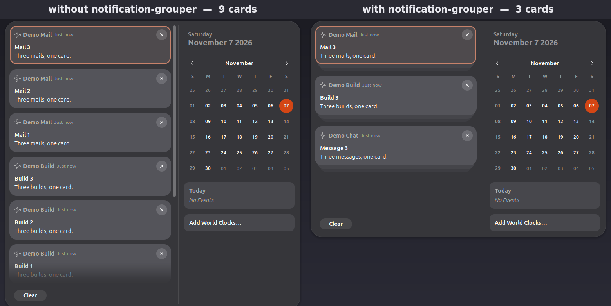

<p align="right"><a href="README.md"><b>English</b></a> | <a href="README.zh-CN.md">简体中文</a></p>

# 🔔 Notification Grouper

A GNOME Shell extension that folds notifications from the same sending
application into a single stack, instead of one stack header per process.


[](https://github.com/SHADE-glitch/notification-grouper)

**What it is** — A GNOME Shell extension that folds notifications from the same sending application into a single stack.

**What it solves** — It stops a wall of identically titled one-card stack headers from command-line and dev tools that get a fresh pid on every send.

**How to run** — Clone into `~/.local/share/gnome-shell/extensions/notification-grouper@local`, run `gnome-extensions enable notification-grouper@local`, then log out and back in.

**Where to look** — See [AGENTS.md](AGENTS.md) and [MAINTENANCE.md](MAINTENANCE.md).

GNOME 50. Works out of the box — the defaults are the whole point, so you never have
to configure anything. Four plain switches exist for when you do want to change
behaviour; there is no rules file and no config format to learn.

<p align="center"></p>

<p align="center"></p>

## 📖 About

An **original extension** by **SHADE-glitch** — not a fork, with no upstream
project to attribute. It was written for GNOME Shell 50 and verified on GNOME
Shell 50.1 / Ubuntu 26.04. The shell-side code is two method wrappers on the
notification daemon, one behaviour override on the sources it creates, and a
self-contained module of workarounds for a GNOME defect; the grouping itself is
one pure-function module. It draws no UI in the notification list, and never
touches the network.

## ❓ The problem

GNOME's Freedesktop.org notification backend caches its sources per
`pid + app_name`. For a long-lived app that is fine. But a command-line or
dev tool that sends one notification and exits gets a **fresh pid every time**,
and therefore a fresh source every time — and nothing ever retires those
sources, because the cleanup path only fires for senders that resolved to a
real `Shell.App`.

The result after a session of build hooks, CI pings and agent completion
notices is a wall of identically titled stack headers in the notification
centre, each holding one card.

This extension makes those share one source, keyed on the application that
sent them.

## 🚫 What it does not do

Read this before opening an issue — several of these are deliberate.

- **Notifications from an app that resolves to a `Shell.App` are left
  completely alone.** Native GNOME already stacks those per app; there is
  nothing to fix and this extension does not touch them.
- **Senders that declare no name at all are left alone.** The group key is the
  identity the sender declares, so a generic `app_name` such as `notify-send`
  or `node-notifier` is grouped under that name — one stack for `notify-send`,
  a separate one for `node-notifier`. Only a genuinely empty `app_name` counts
  as "this sender does not identify itself" and is left to native per-pid
  isolation. The flip side: two unrelated tools that both send as bare
  `notify-send` will share one stack. Give the sender a distinct `--app-name`
  (or a `desktop-entry` hint) if you want them kept apart.
- **No rules engine.** Per-app branches, rule files and title patterns were all removed
  from the grouping logic; the engine contains no application name at all. Grouping is a
  pure function of the identity the sender declares. What remains configurable is four
  switches ([Settings](#settings)), none of which re-introduces matching: the only list
  you can fill is a set of application names to leave alone.
- **The stack size cap does not re-implement GNOME's trimming.** GNOME keeps at most
  10 notifications per source (`messageTray.js:25`, oldest destroyed synchronously at
  `:577-580`). `max-per-source` goes 1..30: at 10 or below that native rule is the whole
  story and nothing extra is mounted; above it the extension only keeps GNOME from firing,
  and GNOME's own `addNotification` still does the work. See
  [Known limitations](#known-limitations) for what merging does to that cap.
- **No UI of its own.** Icons, titles, banners and urgency are all left to GNOME. The
  extension injects no buttons and overrides no headers. The only click-behaviour
  differences are the two narrow ones described under
  [Click behaviour to expect](#click-behaviour-to-expect-native-not-configurable)
  — both applied **only to the stacks this extension itself serves**.

## 🔬 How it works

Two methods are wrapped on the FDO backend instance
(`Main.notificationDaemon._fdoNotificationDaemon`):

| Patch point | Role |
| --- | --- |
| `NotifyAsync` | Reads the hints at the entry point, computes the group, stashes the result |
| `_getSourceForPidAndName` | Consumes the stash; returns a shared source, or falls through to native |

Both methods must exist for anything to be installed. If either is missing the
extension stays completely inert and logs one warning — it never half-attaches.

On top of those two, every stack this extension serves gets **per-instance** overrides and
nothing else: `open()` (below) and, only when the cap is raised past GNOME's own,
`addNotification`. Stacks that already exist when the extension attaches are adopted into
the same treatment — [Known limitations](#known-limitations) says why, and what adoption
still cannot fix.

### Click behaviour of the merged source

Native `FdoNotificationDaemonSource.open()` does two things: it activates the owning
app, then calls `destroyNonResidentNotifications()` — which destroys **every**
non-resident notification in the source. Native caches one source per sender, so a
source almost always holds exactly one card and the mass-destroy is invisible. Merging
turns that one source into the whole group, so the same call used to wipe the entire
stack: click a card that has no place to jump to, and the list emptied while the
calendar stayed open — a blank page, with the group gone.

The extension therefore **overrides `open()` on the sources it serves** (and only
those): it keeps the app-activation half and drops the mass destroy. The clicked card
still goes away on its own, because `Notification.activate()` calls `destroy()` on the
non-resident notification. Net effect: clicking one card removes exactly that card — and
clicking the last card of a stack closes the notification page, which native does only for
a stack that has an app to activate, and a merged stack never has one.

For the same reason it diverts the **close** path: closing a card in a *collapsed*
group normally closes the whole group (`messageList.js:1107-1112` — a per-source behaviour
that only became visible once groups grew). The extension turns that into "close this
card", again only for collapsed groups whose source it created.

Both are strictly scoped to stacks this extension creates; native sources and expanded
groups keep native behaviour. See [Click behaviour to expect](#click-behaviour-to-expect-native-not-configurable)
and [Known limitations](#known-limitations).

The stash is a single slot, which is safe because the shell-side `NotifyAsync`
is a plain synchronous method — there is no `await` between reading the hints
and resolving the source, and D-Bus dispatch on that connection is not
reentrant. As a guard against that assumption being broken by a downstream
patch, the stash also carries two consistency fields — the sender pid and the raw
`app_name` — and either one disagreeing with the second call drops the
notification back to native untouched with a single warning. The pid alone only
catches cross-process misalignment; the name catches one process interleaving
sends under different names, which is the case that would merge into the wrong
stack.

`disable()` restores both methods, every per-instance override (`open()` and the cap
override), disconnects the per-source and settings handlers, clears the cache, **destroys
the merged sources it created** and **hands back the sources it adopted**. Destroying is
not cosmetic for the ones it created: such a source holds a D-Bus name watch and a
notification policy that are only released by `Source.destroy()`
(`messageTray.js:597-609`), and once `open()` has been restored to the native one, leaving
the source alive would put "click one card, lose the whole group" back on the table —
after disabling. An adopted source is different: its cards were never this extension's, so
retiring them would break "disabling touches nothing native", and it is simply returned to
native ownership. See [Known limitations](#known-limitations).

### Group key

First match wins:

1. the `desktop-entry` hint
2. an application id (reserved for portal/Gtk paths; the FDO path rarely has one)
3. the normalised `app_name`, whenever it is non-empty — generic names included

Normalisation is: trim, lowercase, strip a trailing `.desktop`. So `Foo`,
` foo.desktop ` and `FOO` all land in the same group.

The hot path is a pure function with no regex, no file IO and no timers.

<a name="settings"></a>

## ⚙️ Settings

Open them from the **Extensions** app, or:

```sh
gnome-extensions prefs notification-grouper@local
```

Everything applies **immediately** — you do not have to disable and re-enable, and you do
not have to log out. The page has a restore-defaults action for all five keys at once.

| Setting | Key | Default | What it does |
| --- | --- | --- | --- |
| Group by app | `grouping-enabled` | on | Off = back to stock GNOME: one stack per sending process. |
| Cards kept per stack | `max-per-source` | 10 | How many cards one merged stack keeps before the **oldest** is dropped. 1..30. At 10 or below this is GNOME's own rule and nothing extra runs; above it the extension keeps GNOME from dropping the card. |
| Work around GNOME's notification-list defects | `ui-guards` | on | The two behaviours described under [the workaround section](#-workaround-for-a-gnome-50-notification-list-defect). Turn it off only to compare against unpatched GNOME. |
| Apps that keep their own stacks | `isolate-apps` | empty | Names listed here are never merged. Matched on the identity actually used for the group key, after trimming and lower-casing; a trailing `.desktop` is ignored. |
| Log notifications left out of a stack | `log-fallthrough` | off | One journal line per notification that was not merged, naming the reason and the app. The only way to answer "why is this app in two stacks" from a running session. Never logs the message text. |

Values live under
`org.gnome.shell.extensions.notification-grouper` in dconf, and the extension reads them
once at enable plus on every change — nothing is read on the notification hot path. The
defaults are exactly the behaviour described above, so a fresh install needs no settings
at all.

Three honest edges:

- Turning **Group by app** off does not split the stacks that are already merged; it stops
  new notifications from joining them. Disabling the extension retires the stacks it
  created, and hands back the ones it adopted.
- `max-per-source` applies to the stacks this extension serves. A lower value trims
  existing stacks right away, by design, so the change is visible without waiting for new
  notifications.
- **Log notifications left out of a stack** is the one switch that writes per notification.
  It is off by default, and the extension stays silent between enable and disable while it
  is off.

## 🧩 Compatibility

`shell-version` declares `50` only. That is the version the two patch points and
the resulting behaviour were verified against (GNOME Shell 50.1, Ubuntu 26.04).
Versions 48 and 49 look source-compatible but were not run, so they are not
claimed.

Note that GNOME's own compatibility check compares **major versions only**, so
this extension will keep loading unchanged on 50.2, 50.3 and so on. Because it
depends on a private method name, that name may be renamed in a point release.
The failure mode is designed for that: the extension goes inert and logs one
line, rather than throwing.

To check which case you are in:

```sh
journalctl --user -b | grep notification-grouper
```

Healthy:

```
[notification-grouper] enabled, attached patches: NotifyAsync, _getSourceForPidAndName
```

Upstream renamed something — please open an issue with this line:

```
[notification-grouper] WARNING degraded, staying inert: ...
```

## 🔒 Privacy

- Notification **bodies are never written to the log**, and there is no
  per-notification logging: one line per enable, one per disable, and a
  line or two when you flip a switch. The one exception is the opt-in
  **Log notifications left out of a stack**, which exists to be per notification.
- No network access. The extension writes no files and keeps no state of its own
  beyond the five settings keys you change in the prefs page (dconf, standard
  GNOME storage — clear them by uninstalling or with `dconf reset`). The only
  thing it reads per notification is the sender-declared identity already present
  in it.

## 📥 Install

Requires GNOME Shell 50 on Ubuntu (verified on Ubuntu 26.04 with GNOME Shell
50.1). No build step and no dependencies beyond `git`.

```sh
# 1. clone straight into the extensions directory
git clone https://github.com/SHADE-glitch/notification-grouper.git \
  ~/.local/share/gnome-shell/extensions/notification-grouper@local

# 2. enable it
gnome-extensions enable notification-grouper@local
```

You can also enable it from the **Extensions** app.

**Log out and back in** — that is the reliable way to load a freshly cloned
extension. Toggling it off and on does **not** reload edited JavaScript: the
shell caches ES modules per process, so verifying a code change needs a shell
restart. (Settings are different — they apply live, see
[Settings](#settings).)

The compiled schema (`schemas/gschemas.compiled`) is committed, so there is
nothing to generate after cloning; GNOME 50 no longer compiles schemas shipped
by extensions.

### Uninstall

```sh
gnome-extensions disable notification-grouper@local
rm -rf ~/.local/share/gnome-shell/extensions/notification-grouper@local
```

## 🔨 Development

```
extension.js       daemon wrappers, merged-source cache, settings, enable/disable
groupEngine.js     pure functions: normalisation, grouping, patch-point self-checks
uiWorkarounds.js   the GNOME-defect workarounds, as one deletable unit
prefs.js           the settings page (own GTK process; never loaded by the shell)
schemas/           the gsettings schema; gschemas.compiled is committed, so no build step
tests/             node suite + headless runtime harnesses
scripts/bench.mjs  engine microbenchmark
```

`groupEngine.js` deliberately imports nothing from `gi://` or `Shell`, so the
same file runs under both GJS and Node and the grouping logic is testable
without a live session:

```sh
npm test                   # engine unit tests + repository-level guards, no shell needed
npm run check              # node --check over every shipped JS file
npm run bench              # engine throughput
npm run check:prefs        # prefs.js may only use Adw/Gtk members that exist here (gjs)
npm run verify:headless    # runtime assertions in a throwaway shell; prints its own count
npm run verify:ui-guard    # provokes the native defect; the verdict must FLIP between builds
npm run verify:provoke     # breaks each settings path in a /tmp copy; each must turn red
```

Neither harness counts is quoted in this file on purpose — a hand-copied total goes stale
on the first added assertion and then reads as evidence when it is noise. Both commands
print their own number.

`npm test` covers the engine and the repository, **not** runtime behaviour: only
`tests/headless-verify.sh` executes `extension.js`. The two headless harnesses boot a
private GNOME Shell (`dbus-run-session`, `GSETTINGS_BACKEND=memory`, a private
`XDG_DATA_HOME`) so they never touch your session, your settings, or your notification
tray. `tests/headless-ui-guard.sh` runs the same assertion against two builds, so it must
*flip* between them; a probe that merely passes on the new code proves nothing.

The harnesses also encode traps that cost real time to discover: GNOME 50 rejects
symlinked extension directories (copy instead), `--nested` was removed, `gdbus` parses a
bare `-1` argument as an option, `GLib.spawn_async` returns a pid rather than a
subprocess handle, and `WeakRef` cannot be used to detect leaks because GJS does not
collect GObject wrappers on demand.

The JSON fixtures under `tests/fixtures/` were captured with `dbus-monitor` from
real notifications. Bodies are emptied, D-Bus bus names replaced with placeholders and
application names replaced with generic ones; sender pids are kept, because "every
invocation has a different pid" is the premise the whole extension rests on and the
fixtures are the evidence for it.

## 🧪 Testing

`npm test` is the offline gate and needs no shell: the engine unit tests
(`tests/test-groupEngine.mjs`) plus the repository guards (`tests/repo.test.mjs` — bilingual
doc pair, zero-timer grep, patch-point ownership, no-Gtk-in-shell-process, records free of
application names, `reports/` untracked). `npm run check` and `npm run check:prefs` are the
static and gjs checks; `npm run check:log` gates the CHANGELOG coverage.

The runtime harnesses boot a private GNOME Shell and are deliberately **not** run in CI:
`npm run verify:headless`, `npm run verify:ui-guard` and `npm run verify:provoke` (see
[Development](#-development) for what each proves). Each command prints its own count, which
is never copied into this file.

## 🩹 Workaround for a GNOME 50 notification-list defect

GNOME 50's own `ui/messageList.js` has a race that can leave the notification list
**frozen — clicking anything does nothing**. This extension ships two narrow guards
against it.

Why an extension for *grouping* patches shell UI: grouping makes stacks bigger, and a
bigger group is what makes the pre-existing defect reachable. Native caches one source per
`pid + app_name`, so most groups held exactly one card and never hit the path. Merging
converts many one-card groups into a few N-card groups, so the exposure moves from
near-zero to occasional. That is a consequence of this feature, so mitigating it is this
extension's business.

The defect, verified against GNOME Shell 50.1 line numbers:

1. `_removeNotification` reads `item.layout_manager` at `messageList.js:1161`, but only
   deletes its map entry inside the animation callback at `:1170`. A throw at `:1161`
   therefore leaves a **stale message** in `_notificationToMessage`.
2. `collapse()` then iterates that stale entry at `:992`, and `Message.unexpand` (`:646`)
   calls `ease_property('@layout.expansion', …)`.
3. `ease_property()` **is** `_easeAnimatableProperty`, a plain function and **not `async`**
   (`ui/environment.js:196`), so the `TypeError` is raised synchronously inside that loop.
4. `collapse()` is `async` but has no `try/finally`, so the throw only rejects the promise it
   hands back: `_expanded = false` (`:998`) and `_cover.show()` (`:1000`) never run, and the
   single `.catch()` in the method (`:1006`) belongs to `collapse()`'s own
   `ease_property_async` **after** the loop, so it cannot intercept this. A caller that does
   not await `collapse()` just logs a JS ERROR. The group is stuck half-collapsed forever,
   and from then on every click is swallowed by the `if (!this.expanded)` branch at
   `:1114-1119`.

The guards: `Message.unexpand` lands its end state instead of throwing when the actor has
no layout manager (which lets the loop finish for the remaining messages), and
`NotificationMessageGroup.collapse` forces **every step native would have run after that
loop** — expanded flag, `expanded` signal, cover, stacked fade, header hide — to land if
anything still throws.

Both guards are **strictly independent of grouping** — reached by dynamic `import()`, so a
GNOME version that renames `messageList.js` costs you only the guards, never grouping. They
work around a bug that belongs upstream; **delete them once GNOME fixes it**, and please
open an issue if you see `UI guards degraded` in the journal.

They live in `uiWorkarounds.js`, which is that whole deletion unit — one file plus its own
harness. Until upstream fixes the defect, the **Work around GNOME's notification-list
defects** switch turns them off at runtime if you want to compare against stock GNOME.

### Click behaviour to expect (native, not configurable)

- **Clicking a card in a collapsed multi-card group does not activate it — it only
  expands the group.** `messageList.js:1114-1119` stops the click emission and turns it into an
  expand request. A group of exactly **one** card is treated as already expanded (`:952`),
  which is why small native groups appeared to "click and dismiss". Merged groups are
  multi-card, so expect the first click to expand and the click on the revealed card to act.
- **Clicking a card in an expanded group no longer empties the group.** Before this
  extension overrode it, `Source.open()` cleared the whole source; now only the clicked
  card is removed, and the rest of the group stays (see
  [Click behaviour of the merged source](#click-behaviour-of-the-merged-source)).
- **A notification from a sender that does not resolve to an application can never jump
  anywhere.** `openApp()` returns immediately when `source.app` is null, and the path this
  extension handles is precisely the path where it is null. Whether a click launches
  something is decided by the *sender* offering a `default` action
  (`notificationDaemon.js:232-241`) — no extension can retrofit it. What this extension
  does change is what happens *after* such a click: on the last card of a stack the page
  closes, so the click is not mistaken for nothing having happened.
- **Clicking one card's close button now closes just that card**, in a collapsed merged
  group too (native would have closed the whole group there). Nothing closes a whole stack
  in one click — see [Known limitations](#known-limitations).

<a name="known-limitations"></a>

## ⚠️ Known limitations

- **The first click on a collapsed merged group only expands it** (native `:1114-1119`); the
  action fires on the second click. This is unavoidable without re-implementing click
  handling, and it mirrors what a native multi-card stack does.
- **A merged stack drops its oldest card sooner than GNOME does.** GNOME keeps at most 10
  notifications *per source* and destroys the oldest synchronously when the eleventh
  arrives (`messageTray.js:25`, `:577-580`, reason `EXPIRED`). Native sources hold roughly
  one card each, so almost nothing is ever dropped; merging puts a whole application's
  cards in one source, so the tenth card of a *busy app* now costs the first one.
  `max-per-source` goes up to 30, and above 10 the extension keeps GNOME from firing that
  drop — see [What it does not do](#-what-it-does-not-do) for how. A sender that floods
  you is still better silenced at the source than filtered here.
- **A `desktop-entry` hint that names a non-existent `.desktop` file decouples
  the group key from the stack title.** The group is keyed on the hint while
  the title comes from `app_name`. Narrow case — real GTK apps resolve to an
  `App` and take the native path — but two applications sharing such a hint
  would land in one stack.
- **A notification that arrives in the first few hundred milliseconds of the session can
  still sit in a stack of its own.** The notification daemon answers `Notify` before the
  extension is enabled — measured at login, 621 ms — and merging happens when a
  notification's source is resolved, a moment that has already passed. Attaching now
  adopts those stacks, with two limits: the hint that the grouping key prefers is gone by
  the time the adoption looks, so the key is rebuilt from the stack's declared title
  (the `app_name` branch only), and when two stacks declare the same title the first one
  wins, because pulling the second's cards into it would need re-parenting, which GNOME
  does not allow (`source` is construct-only). If it ever reappears, turn on
  **Log notifications left out of a stack** and the journal says which branch the
  notification took.
- **Disabling tears down the merged stacks it created.** On `disable()` the sources this
  extension created are destroyed, which retires the cards still sitting in them. This is
  deliberate: those sources hold a D-Bus name watch and a notification policy that only
  `destroy()` releases, and leaving them alive with the native `open()` restored would
  re-create the bug this extension exists to fix. **Adopted** stacks are handed back
  instead, untouched — nothing already sent to a native stack is retired. Turning
  **Group by app** off is the gentler option: it stops new notifications from merging and
  keeps existing stacks. The lock screen does not reach
  this path: `metadata.json` declares `session-modes` `["user", "unlock-dialog"]`, so
  GNOME keeps the extension active while locked. Without that key GNOME disables the
  extension on lock, `disable()` runs, and every merged stack is retired.
- **Cards that *disabling* retires reach the sender as `NotificationClosed` with reason 2
  (`DISMISSED`)**, not "expired" and not the `undefined` this document used to claim.
  Native `FdoNotificationDaemonSource.destroy()` does drop the reason argument
  (`notificationDaemon.js:384-391`), but `Source.destroy()` then passes its `undefined`
  along to `Notification.destroy(reason = DISMISSED)` (`messageTray.js:488`, `:596-600`),
  where the default parameter fills it in. Measured on the harness bus: 22 closes from one
  disable, all reason 2. The only way to change it is to patch a third method, which is
  not worth a signal most senders ignore. Cards removed by the **per-stack cap** are not
  like this: they keep `EXPIRED`, which the FDO layer reports as reason 1
  (`notificationDaemon.js:178-195`) — and the headless harness asserts that reading on the
  bus, from a separate observer, not just as an in-process value.
- **Nothing closes a whole stack in one click.** Native would have: in a collapsed group,
  closing one card closed the group, and that is the defect this extension turns into
  "close this card" (see [the workaround section](#-workaround-for-a-gnome-50-notification-list-defect)).
  Merging is what made the difference visible: a 10-card stack now costs 10 clicks to
  clear by hand. The list's own **Clear** button still dismisses everything at once.
  Adding a per-stack clear would mean injecting a button, which this extension does not
  do.
- The extension UUID is `notification-grouper@local`.

### Troubleshooting

Read the journal first; the extension is silent unless something is worth saying.

```sh
journalctl --user -b | grep -i notification-grouper
```

- **Nothing is merged, one stack per process again.** The senders probably declare no
  identity at all. A genuinely empty `app_name` is left to native on purpose. Have the
  sender pass `--app-name` (or a `desktop-entry` hint) and it becomes groupable.
- **Two unrelated tools share a stack.** They both send as a generic name such as
  `notify-send`. Add one of them to **Apps that keep their own stacks**.
- **One app sits in two stacks, same title.** That app sent something before the
  extension was attached — at session start, where the daemon answers `Notify` a few
  hundred milliseconds first. Attaching adopts such stacks, so a *new* notification from
  that app should land in the adopted one; if it does not, turn on **Log notifications
  left out of a stack**, send one, and the journal names the branch that took it. The
  stale stack itself is a normal native stack: dismissing its card clears it.
- **`WARNING degraded, staying inert`.** GNOME renamed one of the two daemon methods this
  extension wraps. Please open an issue with that line; grouping is off until it is fixed.
- **`UI guards degraded` / `UI guards attach failed`.** `ui/messageList.js` could not be
  loaded, so only the defect workarounds are missing — grouping still works. If your GNOME
  version no longer has the underlying defect, this is expected and harmless.
- **The notification list froze anyway, after disabling.** That is the GNOME defect itself;
  the guards are what prevents it, so re-enable the extension (or report it if they are
  already on).

## 🤝 Contributing

Issues and pull requests are welcome. Please keep changes scoped, and run the
test suite described under [Development](#-development) before opening a PR.

## ⚖️ License

GPL-2.0-or-later · `SPDX-License-Identifier: GPL-2.0-or-later`. See [LICENSE](LICENSE) — it is the verbatim FSF text, which is why GitHub's automatic detector reports plain GPL-2.0; the declaration above is what is actually granted.

---

Full Chinese documentation: [README.zh-CN.md](README.zh-CN.md).
